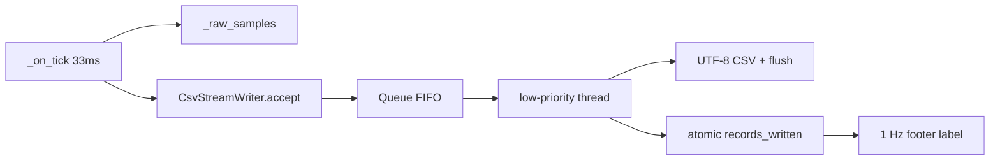

# Continuous CSV streaming

CSV is currently a one-shot dump of in-memory samples from **File → Save Raw Data**. Capture already runs at 33 ms in [`iograph/tracker.py`](c:\Users\pho\repos\EmotivEpoc\ACTIVE_DEV\IOGraph\iograph\tracker.py); LSL is the only live output path. This adds a parallel disk stream without replacing Save Raw Data.

## Mode and output location

- New Options checkbox **Stream CSV Continuously**, default **ON** (`QSettings` key `options/stream_csv`).
- New Options action **Choose CSV Output Folder…** stores `options/csv_output_dir`.
- Resolve directory in this order: dedicated CSV folder if it exists → last Save Image/Raw Data folder → Desktop → home. Create the folder if missing.
- Filename at session start (stable path, no duration suffix): `IOGraphica - YYYY-MM-DD_HH-MM-SS.csv`. If the path exists, append `_001`, `_002`, …
- Keep **Save Raw Data** unchanged.

## Writer service

New Qt-free [`iograph/services/csv_stream.py`](c:\Users\pho\repos\EmotivEpoc\ACTIVE_DEV\IOGraph\iograph\services\csv_stream.py):

- `start(path, initial_rows=())` — open UTF-8 file, write `x,y,time` header, enqueue restored/existing rows, start daemon thread.
- `accept(x, y, t, *, appended)` — non-blocking; called from the capture tick.
- `stop()` — flush pending idle, send sentinel, join, close.
- Same row encoding as [`TrackCanvas.export_csv_text`](c:\Users\pho\repos\EmotivEpoc\ACTIVE_DEV\IOGraph\iograph\tracker.py): movement `int(round(x)),int(round(y)),t`; idle `,,t`.
- **Compact idle** (required for cost): consecutive idle ticks only update a pending timestamp; one idle row is written when movement resumes or on pause/stop/quit. This matches Save Raw Data and avoids ~30 idle lines/sec.
- Background loop: drain a `queue.Queue` (max ~4096), write a batch, `flush()`. Periodic `os.fsync` (about once per second) for crash durability. If the queue is full, drop the oldest queued item rather than blocking the 33 ms timer.
- Thread priority: Windows `THREAD_PRIORITY_LOWEST` via `SetThreadPriority`; POSIX `os.nice(10)` best-effort.
- `records_written` is an atomic int incremented after a successful write (header not counted). Footer reads this; it does not stat the file on the UI thread.

## Session lifecycle

Hook in [`MainWindow._set_tracking`](c:\Users\pho\repos\EmotivEpoc\ACTIVE_DEV\IOGraph\iograph\main.py) / reset / quit, not inside the painter.

| Event | File behavior |
|---|---|
| First start of a session (including auto-start on launch) | Create file, write header, bulk-enqueue current samples (covers session restore), then live-append |
| Pause | Flush pending idle; **keep the same file open** |
| Resume | Continue appending to the same file |
| Reset | Close current file; if still tracking, open a new timestamped file |
| Toggle option ON while tracking | Open a new file and bulk-enqueue current samples, then live-append |
| Toggle option OFF | Flush and close |
| Change output folder while streaming | Remember the new folder; current file stays put until the next session file is created |
| Quit / `closeEvent` | `stop()` before process exit so the last batch is on disk |

Tracker change is a small sink callback after `_raw_samples` is updated in `_on_tick`, with `appended=False` on idle-timestamp overwrite so the writer can update pending idle without extra rows.

Open the writer **before** `start_tracking()` so the first ticks cannot race the header.

If create/open fails (permissions, disk), leave tracking running, keep the checkbox on, show a short footer error, and do not crash.

## Footer

[`build_front_panel`](c:\Users\pho\repos\EmotivEpoc\ACTIVE_DEV\IOGraph\iograph\ui\panel_widgets.py) is already 66 px (36 + 16 + margins). Add a third label under `period_label`:

- Font ~9–10 pt, `ElideMiddle`, tooltip = full path.
- Text: `{path}  ·  {count} records` (localized template).
- Visible only while a stream file is open (or after a start failure).
- Update from the existing 1 s `_ui_timer` in `_update_timer_label` — not from the 33 ms tick.

Raise [`MainWindow.PANEL_HEIGHT`](c:\Users\pho\repos\EmotivEpoc\ACTIVE_DEV\IOGraph\iograph\main.py) from 66 to **82** so the extra line fits; the setup-panel slide already uses `PANEL_HEIGHT`.

## Settings / i18n / smoke

- Keys in [`iograph/services/settings.py`](c:\Users\pho\repos\EmotivEpoc\ACTIVE_DEV\IOGraph\iograph\services\settings.py); load/save beside the other options; default stream flag `True` when unset.
- Options menu in [`iograph/ui/menu_builder.py`](c:\Users\pho\repos\EmotivEpoc\ACTIVE_DEV\IOGraph\iograph\ui\menu_builder.py) (not the cramped 2×2 settings grid; tray has no other option checkboxes, so skip tray).
- New i18n ids in [`iograph/services/i18n.py`](c:\Users\pho\repos\EmotivEpoc\ACTIVE_DEV\IOGraph\iograph\services\i18n.py) for all 21 languages (release gate is 100% required coverage): checkbox, folder action, footer template, folder dialog title, start-failed footer.
- Add `iograph.services.csv_stream` to [`scripts/smoke_regression.py`](c:\Users\pho\repos\EmotivEpoc\ACTIVE_DEV\IOGraph\scripts\smoke_regression.py).
- After edits: `python -m compileall iograph` and `python scripts/smoke_regression.py`.

## Out of scope

- Splitting files by duration (video-recorder style).
- Changing LSL, NDJSON session restore, or the one-shot Save Raw Data dialog.
- Writing idle rows every tick.