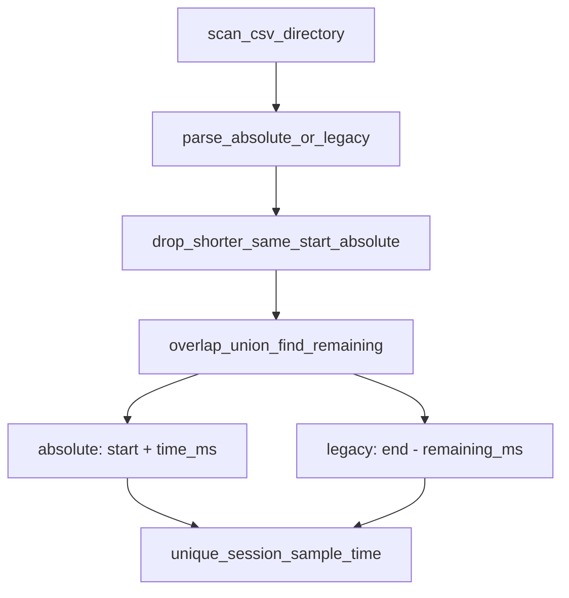

# Fix same-start incremental IOGraph CSV merge

## Problem

Manual “Save Raw Data” produces incremental absolute names that share one start stamp and grow duration, e.g.:

- [`IOGraphica - 2026-11-09_12-34-12_14.8083h.csv`](c:/Users/pho/repos/EmotivEpoc/ACTIVE_DEV/IOGraph/data/test_output/IOGraphica%20-%202026-11-09_12-34-12_14.8083h.csv)
- [`IOGraphica - 2026-11-09_12-34-12_15.7639h.csv`](c:/Users/pho/repos/EmotivEpoc/ACTIVE_DEV/IOGraph/data/test_output/IOGraphica%20-%202026-11-09_12-34-12_15.7639h.csv)

Later files are supersets of earlier ones. Current `build_master_df` still end-anchors each file with `dt_end - (t_max - time)`, so duration vs `tmax` skew (~`-8s` vs `+0.5s`) makes the same relative `time` land on different absolute `sample_time`s. Exact dedupe barely fires → master ≈ **798k** rows instead of ≈ **406k** from the longest file alone.

```301:304:c:/Users/pho/repos/EmotivEpoc/ACTIVE_DEV/PhoPyMNEHelper/src/phopymnehelper/iograph_data.py
            master_pl = (
                pl.concat(parts)
                .sort(["session_index", "file_rank_in_session", "sample_time"])
                .unique(subset=["session_index", "sample_time"], keep="first")
```

## Chosen fix (in PhoPyMNEHelper)

Edit [`iograph_data.py`](c:/Users/pho/repos/EmotivEpoc/ACTIVE_DEV/PhoPyMNEHelper/src/phopymnehelper/iograph_data.py) only.

### Scope constraint (absolute format only)

“Newest/longest CSV wins; earlier same-start saves are supersets we can drop” applies **only** when the basename matches the new absolute pattern (`YYYY-MM-DD_HH-MM-SS_<hours>h`). That pattern is the only reliable same-instance start identity.

Legacy `(from HH-MM to HH-MM)` / dated names must **not** get same-start collapse or start-anchoring:

- their start is minute-resolution and mtime-anchored, so equal starts are not a safe “same app instance” signal
- keep existing overlap union-find + end-anchor + shorter/earlier ranking for those files
- leave `test_overlapping_files_merge_and_dedupe` and `test_incremental_saves_same_start_shorter_wins` unchanged

Gate both new behaviors with `_IOGRAPH_FILENAME_ABSOLUTE_RE.search(file_name)`.

### 1. Same-start absolute collapse (before reading CSVs)

After parsing/`dropna` on `parsed_filename_dt_end`, **only** for absolute-matching rows:

- group by exact `parsed_filename_dt_start`
- keep the single longest export: max `parsed_filename_dt_end`, then `size_bytes`, then `modified_datetime`
- log which shorter absolute siblings were dropped
- concatenate kept absolute rows with all non-absolute rows, then run existing session grouping on the combined table

### 2. Start-anchor absolute samples

When building each part, **only** if the source basename is absolute format:

- `sample_time = parsed_filename_dt_start + Timedelta(milliseconds=time)`
- do **not** use `dt_end` / `t_max` for absolute files

Legacy files keep current end-anchoring (`dt_end - (t_max - time)`).

This matches the absolute producer contract: filename start is the wall-clock session start; CSV `time` is ms from that start.



### 3. Ranking docstring

Update `_subfn_assign_session_groups` comments: absolute same-start supersets are removed upstream; remaining overlap ranking stays for different-start / legacy cases.

## Tests

Primary suite: [`PhoPyMNEHelper/tests/test_iograph_processor.py`](c:/Users/pho/repos/EmotivEpoc/ACTIVE_DEV/PhoPyMNEHelper/tests/test_iograph_processor.py)

- Replace `test_absolute_incremental_saves_same_start_shorter_wins` with **keep-longest**: same start `0.5h` + `1.0h` → only longer file’s rows; coords from longer; no duplicate `sample_time`; first sample at `start + 0ms` (start-anchored).
- Add **real-fixture** test (skip if missing) that copies/scans only those two `data/test_output` absolute CSVs into a temp dir:
  - one `session_index`
  - `duplicated(sample_time) == 0`
  - `len(master) ==` valid-row count of the `15.7639h` file alone
  - all `source_file_name` from the longer file
  - early `sample_time ≈ start + first_time_ms` (within 1 ms)
- Keep legacy overlap / shorter-wins tests as-is (different-start or legacy naming).

Mirror the absolute keep-longest rename/assertions in [`pyPhoTimeline/tests/test_iograph_recordings_datasource.py`](c:/Users/pho/repos/EmotivEpoc/ACTIVE_DEV/pyPhoTimeline/tests/test_iograph_recordings_datasource.py).

IOGraph [`tests/`](c:/Users/pho/repos/EmotivEpoc/ACTIVE_DEV/IOGraph/tests/) stays producer naming-only (no `phopymnehelper` dependency); real merge coverage lives with the processor.

## Validation

- `uv run pytest tests/test_iograph_processor.py -q` in PhoPyMNEHelper
- `uv run pytest tests/test_iograph_recordings_datasource.py -q -k "absolute or incremental or overlapping"` in pyPhoTimeline
- No IOGraph packaging/export changes.