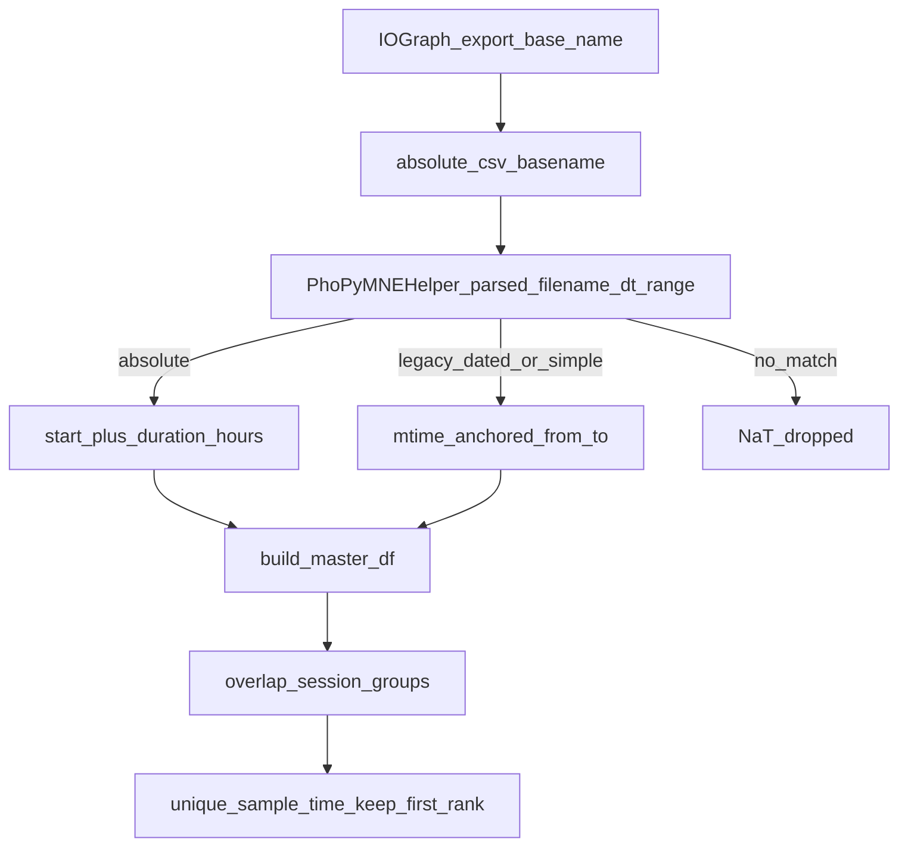

# Support absolute IOGraph CSV filenames + unit tests

## Problem

[iograph_data.py](c:/Users/pho/repos/EmotivEpoc/ACTIVE_DEV/PhoPyMNEHelper/src/phopymnehelper/iograph_data.py) only recognizes legacy names with `(from HH-MM to HH-MM)` (optionally with month/day labels), anchoring the calendar day via file mtime. New Save Raw Data names from [session_controller.export_base_name](c:/Users/pho/repos/EmotivEpoc/ACTIVE_DEV/IOGraph/iograph/core/session_controller.py) look like:

`IOGraphica - 2026-11-09_12-34-12_14.8083h.csv`

That string matches neither legacy regex, so `_parsed_filename_dt_range` returns NaT and `build_master_df` drops the file via `dropna` on `parsed_filename_dt_end`. CSV body schema is unchanged (`x,y,time` with relative ms), so only filename-to-interval parsing needs to change on the consumer side.

IOGraph currently has **no pytest unit tests** (CI runs `scripts/smoke_regression.py` only). Producer naming should be locked with a small unit suite so the absolute pattern does not regress.

## Chosen semantics

For the absolute Save Raw Data format:

- `dt_start` = naive local wall clock from `YYYY-MM-DD_HH-MM-SS` in the basename (same clock as IOGraph `strftime`, no timezone suffix).
- `dt_end` = `dt_start + Timedelta(hours=<float before h>)` (e.g. 14.8083).
- Absolute parsing does **not** require `modified_datetime` (unlike legacy formats).
- Precedence in `_parsed_filename_dt_range` / vectorized scan: absolute, then dated, then simple, then NaT.
- Leave `build_master_df` absolute-time math and overlap/dedupe as-is: still end-anchor samples with `sample_time = dt_end - (t_max - time) ms`, still union overlapping filename intervals, still rank by earlier `parsed_filename_dt_end` then start/mtime/size so incremental same-start saves keep the shorter export on overlaps.

## Implementation

### 1. Parser in PhoPyMNEHelper `iograph_data.py`

Add a module regex matching `YYYY-MM-DD_HH-MM-SS_<float>h`.

In `_parsed_filename_dt_range`:

1. Try absolute match first; on hit parse start and set `dt_end = dt_start + pd.Timedelta(hours=float(duration))`; return without needing mtime.
2. Then keep existing early NaT-on-missing-mtime gate for legacy paths only.
3. Keep dated then simple branches unchanged.

Update `_parsed_filename_dt_ranges_vectorized` to apply the absolute pattern to unmatched rows (prefer vectorized `str.extract` + Timedelta like the simple branch; no mtime gate for absolute rows).

### 2. Unit tests in IOGraph (producer)

Create a new pytest suite under [IOGraph/tests/](c:/Users/pho/repos/EmotivEpoc/ACTIVE_DEV/IOGraph/tests/) — first dedicated unit tests in this repo. Prefer pure helpers that do not require a Qt app:

- [tests/test_export_base_name.py](c:/Users/pho/repos/EmotivEpoc/ACTIVE_DEV/IOGraph/tests/test_export_base_name.py)
  - Construct `SessionController`, set `_started_at` to a fixed datetime, call `export_base_name(elapsed_ms=...)`.
  - Assert exact basename pattern, e.g. start `2026-11-09 12:34:12` + `53280000` ms → `IOGraphica - 2026-11-09_12-34-12_14.8000h` (duration = `round(ms/1000)/3600` formatted to 4 decimals + `h`).
  - Assert filesystem-safe time separators (`-` not `:`).
  - Assert sanitization still strips forbidden path characters from `app_name`.
  - Assert fallback uses “now” shape when `_started_at` is unset (regex match, not exact clock).
- [tests/test_stream_csv_path.py](c:/Users/pho/repos/EmotivEpoc/ACTIVE_DEV/IOGraph/tests/test_stream_csv_path.py)
  - `stream_csv_path(tmp, started_at=...)` → `IOGraphica - YYYY-MM-DD_HH-MM-SS.csv`.
  - Collision allocates `_001` via `unique_csv_path`.

Do not wire these into GitHub Actions in this change unless a one-line pytest step is already trivial; local `pytest tests/` is the validation gate. Smoke regression remains the CI path.

### 3. Unit tests in PhoPyMNEHelper (consumer)

Extend [PhoPyMNEHelper/tests/test_iograph_processor.py](c:/Users/pho/repos/EmotivEpoc/ACTIVE_DEV/PhoPyMNEHelper/tests/test_iograph_processor.py):

- `test_parsed_filename_dt_range_absolute` for `IOGraphica - 2026-11-09_12-34-12_14.8083h.csv` → start `2026-11-09 12:34:12`, end = start + 14.8083h.
- Absolute parse still works when `modified_datetime` is NaT.
- Keep existing simple/dated tests.
- Absolute incremental merge test (same start stamp, `0.5h` vs `1.0h` CSVs): one session, shorter file wins on overlap, longer file supplies the tail — mirroring `test_incremental_saves_same_start_shorter_wins`.
- Lightweight basename check against the real sample name under [IOGraph/data/test_output/](c:/Users/pho/repos/EmotivEpoc/ACTIVE_DEV/IOGraph/data/test_output/); do not load the full ~447k-row CSV in unit tests.

Also mirror the new absolute parse/merge cases into [pyPhoTimeline/tests/test_iograph_recordings_datasource.py](c:/Users/pho/repos/EmotivEpoc/ACTIVE_DEV/pyPhoTimeline/tests/test_iograph_recordings_datasource.py) so the duplicated `TestIOGraphParsing` / `TestIOGraphMerge` suite stays consistent (secondary sync; primary consumer coverage is PhoPyMNEHelper).

### 4. Validation

- `pytest` under IOGraph `tests/` for export/stream naming.
- `pytest tests/test_iograph_processor.py` under PhoPyMNEHelper for parse + merge.
- No IOGraph packaging / export-format code changes beyond tests unless a test reveals a clear bug in `export_base_name`.

## Out of scope

- Changing IOGraph export naming itself (tests lock current behavior).
- CSV schema / column changes.
- Teaching PhoPyMNEHelper to parse streaming no-duration names (covered only by IOGraph path tests).
- Changing end-anchored `sample_time` math or overlap ranking policy.
- Adding pytest to GitHub Actions CI (optional follow-up).
