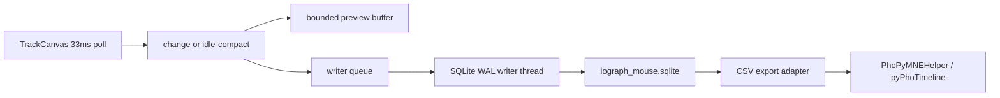

# Longitudinal mouse store: SQLite WAL + CSV export

## Verdict

**Use SQLite in WAL mode as the primary durable format.** It is the best fit for crash-tolerant, multi-day quantified-self / neuroscience mouse logging with easy CSV export and low idle cost. Keep the existing `x,y,time` CSV as an **export / optional stream** format only—not the system of record.

Format comparison (summary):

- **SQLite + WAL**: best crash durability, live append, µs datetime, idle-friendly inserts, indexed longitudinal queries, trivial CSV export, stdlib-only packaging
- **Continuous CSV (current)**: partial crash safety (~1 s fsync; queue can drop); relative ms only; weak longitudinal story via many files + filename clocks
- **NDJSON quit chunks**: weak mid-session durability
- **Parquet / Arrow / HDF5 / DuckDB**: excellent offline analytics, poor or heavy as a live desktop capture primary; extra deps

Parquet/HDF5 remain good **offline analysis** exports later; they are the wrong live writer for a desktop capture loop.

## Why current design is insufficient

Capture today in [`iograph/tracker.py`](c:/Users/pho/repos/EmotivEpoc/ACTIVE_DEV/IOGraph/iograph/tracker.py):

- Polls `QCursor.pos()` at **33 ms**; samples store **relative int ms** from `monotonic()`, not wall-clock µs
- Holds **all** samples in `_raw_samples` for the whole session (RAM grows with movement)
- [`CsvStreamWriter`](c:/Users/pho/repos/EmotivEpoc/ACTIVE_DEV/IOGraph/iograph/services/csv_stream.py) already does compact idle + background flush/fsync, but CSV is not a robust longitudinal DB
- Analysis in [`PhoPyMNEHelper/.../iograph_data.py`](c:/Users/pho/repos/EmotivEpoc/ACTIVE_DEV/PhoPyMNEHelper/src/phopymnehelper/iograph_data.py) expects CSV `x,y,time` with **relative ms** and reconstructs `sample_time` from the filename—so the DB must **not** put wall-clock values in the exported `time` column

## Chosen architecture



### File layout

- One rolling DB file (default under the existing CSV output folder or AppData): `iograph_mouse.sqlite`
- WAL sidecars (`-wal`, `-shm`) while open; clean close checkpoints them
- Optional later: calendar-month rotation if a single file grows huge (not required for v1)

### Schema (v1)

```sql
CREATE TABLE sessions (
  session_id     INTEGER PRIMARY KEY,
  started_at_us  INTEGER NOT NULL,
  ended_at_us    INTEGER,
  app_version    TEXT,
  host           TEXT
);

CREATE TABLE samples (
  session_id  INTEGER NOT NULL REFERENCES sessions(session_id),
  t_wall_us   INTEGER NOT NULL,
  t_mono_us   INTEGER NOT NULL,
  x           INTEGER,
  y           INTEGER,
  PRIMARY KEY (session_id, t_mono_us)
);

CREATE INDEX idx_samples_wall ON samples(t_wall_us);
```

- `t_wall_us`: wall UTC microseconds since Unix epoch (canonical absolute time)
- `t_mono_us`: pause-aware monotonic microseconds for relative export
- `x`/`y` NULL = idle marker

**Timestamp policy**

- Capture both wall (`time.time_ns() // 1000`) and pause-aware monotonic µs
- Export CSV `time` as `int(t_mono_us / 1000)` so consumers stay compatible
- Document platform truth: Windows wall-clock resolution is often ~1 ms even when stored as µs; monotonic/`perf_counter_ns` is better for inter-sample intervals. Optional `lsl_local_clock` can be added later for EEG sync without breaking v1

**Idle policy (no fixed-rate DB growth)**

- Mirror current CSV streamer: while position unchanged, do not insert every tick; keep one pending idle and write/replace only when movement resumes, on pause/stop, or on a ~1 s heartbeat so crash during idle still records last idle time
- Movement: insert only when `(x,y)` changes (storage is event-driven even though capture remains 33 ms polled)

**Crash tolerance**

- Writer thread: batched `executemany` in short transactions; `PRAGMA journal_mode=WAL`; `synchronous=NORMAL`; commit about every 100–500 ms or N rows
- Never block the 33 ms UI tick: same non-blocking queue pattern as `CsvStreamWriter` (drop-oldest under extreme backlog)
- After unclean exit: WAL recovers automatically; start a **new** `sessions` row on next tracking start (simpler integrity than resurrecting an open session)

**Memory / performance**

- Stop treating `_raw_samples` as the longitudinal store for multi-hour/day runs
- Keep a **bounded** in-memory structure for live preview / Save Image
- Full history lives only in SQLite; Save Raw Data / CSV export streams from a DB cursor to file

### CSV compatibility bridge

Export must emit:

```text
x,y,time
2074,933,55
,,890
```

with absolute-style filename from session `started_at_us` + duration hours (same as [`session_controller.export_base_name`](c:/Users/pho/repos/EmotivEpoc/ACTIVE_DEV/IOGraph/iograph/core/session_controller.py)), so PhoPyMNEHelper start-anchoring keeps working. Optional continuous CSV stream can remain as a secondary sink or be demoted to export-on-stop once SQLite is trusted.

Do not change analysis code in v1.

## Implementation touchpoints (IOGraph only for v1)

- New writer: [`iograph/services/sqlite_stream.py`](c:/Users/pho/repos/EmotivEpoc/ACTIVE_DEV/IOGraph/iograph/services/sqlite_stream.py) — queue, WAL, idle compact, export helpers
- Capture: [`iograph/tracker.py`](c:/Users/pho/repos/EmotivEpoc/ACTIVE_DEV/IOGraph/iograph/tracker.py) — wall+mono µs; bounded preview
- Lifecycle/settings: [`iograph/main.py`](c:/Users/pho/repos/EmotivEpoc/ACTIVE_DEV/IOGraph/iograph/main.py) — start/pause/reset/quit; DB path option; footer count
- Session metadata: [`iograph/core/session_controller.py`](c:/Users/pho/repos/EmotivEpoc/ACTIVE_DEV/IOGraph/iograph/core/session_controller.py) — wall start for export naming
- Prefer DB over quit-only NDJSON for durability/restore once restore-from-DB exists

Reuse the writer-thread design from [`csv_stream.py`](c:/Users/pho/repos/EmotivEpoc/ACTIVE_DEV/IOGraph/iograph/services/csv_stream.py).

## Out of scope

- OS mouse hooks instead of 33 ms polling
- PhoPyMNEHelper reading SQLite directly
- Click/button/window-title channels
- Parquet secondary export

## Validation

- `python3 -m compileall iograph`
- Unit tests: idle hours to O(1) rows; crash reopen recovers; CSV export matches relative-ms contract
- Manual: long idle keeps DB size flat; movement inserts at about <=30 Hz; exported CSV loads in PhoPyMNEHelper unchanged
