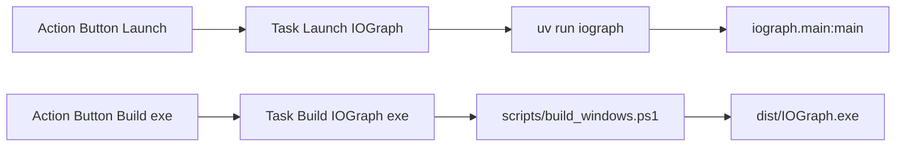

# VSCode launch/build buttons and iograph script

## Context

- Launch entry is already [`run_iograph.py`](c:\Users\pho\repos\EmotivEpoc\ACTIVE_DEV\IOGraph\run_iograph.py) → [`iograph.main:main`](c:\Users\pho\repos\EmotivEpoc\ACTIVE_DEV\IOGraph\iograph\main.py).
- One-file Windows build already exists as [`scripts/build_windows.ps1`](c:\Users\pho\repos\EmotivEpoc\ACTIVE_DEV\IOGraph\scripts\build_windows.ps1) (writes `build/version_info.txt`, then PyInstaller `--onefile` → `dist/IOGraph.exe`). Reuse that; do not invent a second PyInstaller command. CI’s folder-style `--contents-directory runtime` build is a different artifact and stays untouched.
- IOGraph is a **uv virtual project** (`source = { virtual = "." }` in [`uv.lock`](c:\Users\pho\repos\EmotivEpoc\ACTIVE_DEV\IOGraph\uv.lock)). `[project.scripts]` only work after adding a `[build-system]` so uv installs the project editable.
- [`.gitignore`](c:\Users\pho\repos\EmotivEpoc\ACTIVE_DEV\IOGraph\.gitignore) currently ignores all of `.vscode/`. That must be relaxed for the new committed files.
- This repo is usually opened as the multi-root [`IOGraph.code-workspace`](c:\Users\pho\repos\EmotivEpoc\ACTIVE_DEV\IOGraph\IOGraph.code-workspace). Action Buttons should live in workspace settings so the status-bar buttons always show.



## 1. pyproject console script

Update [`pyproject.toml`](c:\Users\pho\repos\EmotivEpoc\ACTIVE_DEV\IOGraph\pyproject.toml):

```toml
[project.scripts]
iograph = "iograph.main:main"

[build-system]
requires = ["hatchling"]
build-backend = "hatchling.build"
```

Hatchling will pick up the existing `iograph/` package (same pattern as PhoPyLSLhelper). No extra Python wrapper for the exe build: that stays the PowerShell script.

Then `uv lock` / `uv sync` so the lockfile switches from `virtual = "."` to an editable install. After that, `uv run iograph` launches the app.

Do **not** add an `iograph-build` console script. Wrapping a Windows-only `.ps1` as a Python entry point is worse than calling the script from the task.

## 2. VS Code tasks

Add [`.vscode/tasks.json`](c:\Users\pho\repos\EmotivEpoc\ACTIVE_DEV\IOGraph\.vscode\tasks.json):

- **Launch IOGraph**: `uv run iograph`, `options.cwd` = `${workspaceFolder}`, dedicated terminal, `isBackground` false. `singleInstance`-style reuse via `"presentation": { "panel": "dedicated", "reveal": "always" }`.
- **Build IOGraph exe**: `powershell -NoProfile -ExecutionPolicy Bypass -File scripts/build_windows.ps1`, `group.kind = build` (so **Terminal → Run Build Task** works).

Both tasks get empty `problemMatcher` arrays so VS Code does not sit in “scanning” forever.

## 3. Action Buttons + extension hint

Add Action Buttons that invoke those tasks (not duplicate shell commands):

```json
"actionButtons": {
  "reloadButton": null,
  "loadNpmCommands": false,
  "commands": [
    {
      "name": "$(play) Launch IOGraph",
      "color": "green",
      "useVsCodeApi": true,
      "command": "workbench.action.tasks.runTask",
      "args": "Launch IOGraph"
    },
    {
      "name": "$(package) Build IOGraph exe",
      "color": "cyan",
      "useVsCodeApi": true,
      "command": "workbench.action.tasks.runTask",
      "args": "Build IOGraph exe"
    }
  ]
}
```

Place this config in:

- [`IOGraph.code-workspace`](c:\Users\pho\repos\EmotivEpoc\ACTIVE_DEV\IOGraph\IOGraph.code-workspace) `settings` (primary; multi-root)
- [`.vscode/settings.json`](c:\Users\pho\repos\EmotivEpoc\ACTIVE_DEV\IOGraph\.vscode\settings.json) (when IOGraph is opened as a single folder)

Add [`.vscode/extensions.json`](c:\Users\pho\repos\EmotivEpoc\ACTIVE_DEV\IOGraph\.vscode\extensions.json) recommending `jkearins.action-buttons-ext` (setting key `actionButtons` also works with the original `seunlanlege.action-buttons`).

## 4. Gitignore

In [`.gitignore`](c:\Users\pho\repos\EmotivEpoc\ACTIVE_DEV\IOGraph\.gitignore), keep ignoring `.vscode/` clutter but force-include the three files:

```
.vscode/*
!.vscode/tasks.json
!.vscode/settings.json
!.vscode/extensions.json
```

## Verify

- `uv sync` then `uv run iograph` starts the GUI.
- Run Task **Launch IOGraph** and **Build IOGraph exe**; confirm `dist/IOGraph.exe`.
- `python -m compileall iograph` (no Python logic change expected; only needed if a wrapper file is added, which this plan does not).
